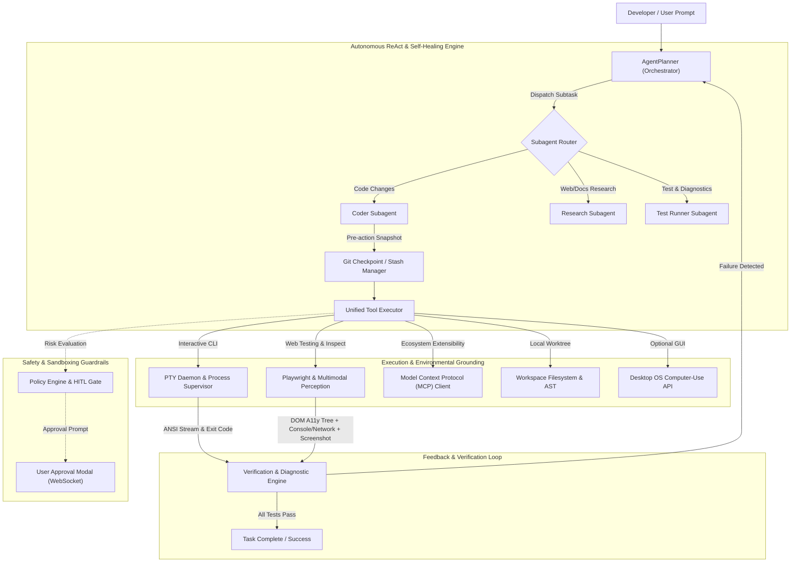
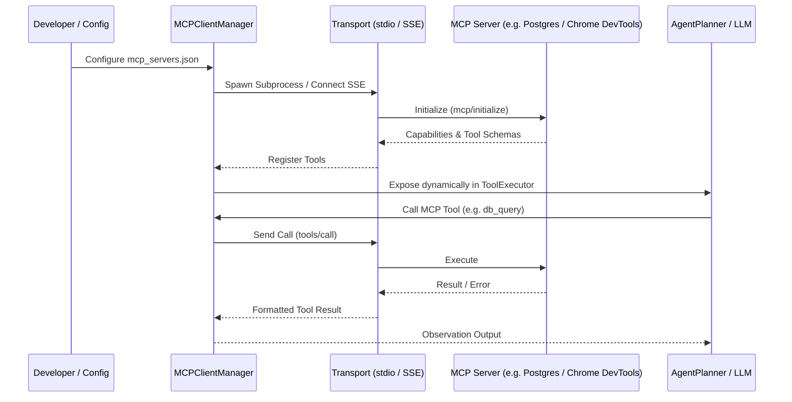
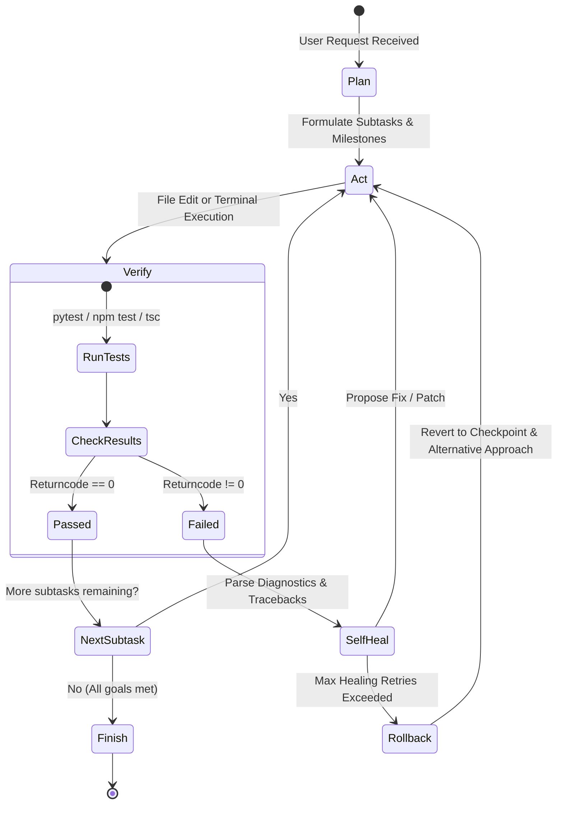

# Architecture & Implementation Plan: Autonomous Agentic Development Environment for Crystal

This document outlines the end-to-end architectural design and phased implementation plan to transform **Crystal** into an enterprise-grade, autonomous agentic development environment. 

---

## 1. Executive Summary & Vision

Crystal currently operates as an AI-assisted code editor with linear single-turn request/response loops, synchronous command execution (`subprocess.run`), and single-agent planning. 

To become a truly autonomous coding harness capable of taking complex software tasks from initial design to end-to-end verification, Crystal requires **environmental grounding, sensory feedback, tool extensibility, and self-healing autonomy**.



---

## 2. Pillar 1: Interactive Terminal & PTY Environment

### 2.1 Problem Statement
Currently, `ToolExecutor.run_terminal` runs `subprocess.run(..., timeout=60)`. It blocks the event loop, cannot handle interactive CLI prompts (`npm init`, `git rebase -i`, REPLs, database CLIs, `python -m venv`), cannot emit real-time streaming logs, and immediately terminates if a dev server runs continuously.

### 2.2 Architecture & Backend Design
1. **Cross-Platform PTY Daemon**:
   - **Windows**: Use `pywinpty` (`winpty.PtyProcess.spawn()`) to create real Windows pseudoconsoles (ConPTY).
   - **Linux / macOS**: Use `ptyprocess.PtyProcessUnicode.spawn()` and standard POSIX `pty`.
   - Maintain a unified abstraction: `backend/services/terminal/pty_session.py`.
2. **Terminal Session Manager (`TerminalManager`)**:
   - Manages multiple concurrent terminal sessions identified by a `session_id`.
   - Handles background stdout/stderr reader threads asynchronously pushing byte chunks into a queue or WebSocket broadcast.
   - Supports bi-directional input (`send_input(data: str)`), terminal resizing (`resize(rows: int, cols: int)`), and signal transmission (`SIGINT / Ctrl+C`, `SIGTERM`, `EOF / Ctrl+D`).
3. **Background Process Supervision (`ProcessSupervisor`)**:
   - Allows long-running daemon processes (e.g. `npm run dev`, `python -m http.server`, `docker compose up`).
   - Maintains a ring buffer (last 50,000 characters) of console logs.
   - Exposes tools to the agent:
     - `terminal_spawn(command, is_daemon=True|False)` &rarr; returns `session_id`
     - `terminal_read(session_id, lines=100, tail=True)` &rarr; inspects recent output
     - `terminal_write(session_id, input_text)` &rarr; answers prompts (e.g. `yes\n`, passwords, options)
     - `terminal_send_signal(session_id, signal="SIGINT"|"SIGTERM")`
     - `terminal_kill(session_id)`
4. **WebSocket Endpoint**:
   - `/ws/terminal/{session_id}` multiplexing user keystrokes, resize events, and agent stdout/stderr.

### 2.3 Frontend Integration
- Install `@xterm/xterm` and `@xterm/addon-fit`, `@xterm/addon-web-links`, `@xterm/addon-search`.
- Implement `frontend/src/components/terminal/TerminalDock.tsx`:
  - Multi-tab terminal interface at the bottom of the editor (VS Code style).
  - Ability to switch between agent-controlled sessions, interactive user sessions, and background daemon logs.
  - Visual badge indicator when a command is executing or requires user interaction.

---

## 3. Pillar 2: Browser Automation & Multimodal Web Perception

### 3.1 Problem Statement
When an agent builds web apps or fixes frontend bugs, it currently works blind. It cannot see layout shifts, render errors, broken assets, or console errors, nor can it interact with documentation sites.

### 3.2 Architecture & Playwright Integration
1. **Playwright Async Lifecycle**:
   - Managed via `backend/services/browser/browser_manager.py` using `playwright.async_api`.
   - Supports both **headless** (for background test runs) and **headed** modes (allowing developers to view the browser window live).
2. **Compact Accessibility Tree (A11y DOM)**:
   - Raw HTML pages are too large and token-expensive for LLMs (often 100k+ tokens).
   - The browser manager extracts a **compact accessibility tree**:
     - Strips scripts, styles, metadata, and non-interactive formatting.
     - Assigns short numeric IDs (`[ref=12] Button: "Sign in"`, `[ref=13] Input: "Password"`) to interactive elements.
     - Allows precise actions: `browser_click(ref=12)`, `browser_type(ref=13, text="secret")`.
3. **Console & Network Telemetry Capture**:
   - Listens to `page.on("console")` &rarr; captures `console.error`, `console.warn`, unhandled exceptions.
   - Listens to `page.on("response")` &rarr; captures HTTP 4xx/5xx network failures and CORS rejections.
   - Packages this telemetry directly into the agent's observation context so the agent knows immediately if a frontend build failed to bundle or hit an invalid endpoint.
4. **Multimodal Visual Inspection**:
   - High-fidelity viewport screenshots via `page.screenshot(type="jpeg", quality=80)`.
   - Downsampled / optimized for Vision LLMs (Gemini 2.0 / GPT-4o / Claude 3.5 Sonnet).
   - Tools exposed:
     - `browser_navigate(url)`
     - `browser_click(element_ref or selector)`
     - `browser_type(element_ref or selector, text)`
     - `browser_press_key(key)`
     - `browser_extract_state()` &rarr; returns text/a11y tree + active errors
     - `browser_screenshot()` &rarr; returns image artifact and visual description
5. **Frontend Live Browser View**:
   - Integrated tab in the bottom dock or side panel (`BrowserPreview.tsx`) showing either a live iframe/stream or screenshot snapshots with interaction overlays.

---

## 4. Pillar 3: Model Context Protocol (MCP) Client

### 4.1 Problem Statement
Building custom adapters for every third-party system (Docker, GitHub, Postgres, Kubernetes, Chrome DevTools) creates maintenance overhead and technical debt. MCP is the open industry standard for LLM tool integration.

### 4.2 Architecture & MCP Client Engine


1. **Client Implementation (`backend/services/mcp/client_manager.py`)**:
   - Built on the official Python `mcp` SDK.
   - Supports both `StdioServerParameters` (local processes spawned via stdin/stdout) and `SSEClientTransport` (remote HTTP/SSE MCP servers).
2. **Configuration (`crystal_mcp.json` / Settings)**:
   - Developers configure servers in their workspace or global settings:
   ```json
   {
     "mcpServers": {
       "chrome-devtools": {
         "command": "npx",
         "args": ["-y", "@modelcontextprotocol/server-chrome-devtools"]
       },
       "postgres": {
         "command": "npx",
         "args": ["-y", "@modelcontextprotocol/server-postgres", "postgresql://localhost/mydb"]
       },
       "github": {
         "command": "npx",
         "args": ["-y", "@modelcontextprotocol/server-github"],
         "env": { "GITHUB_PERSONAL_ACCESS_TOKEN": "..." }
       }
     }
   }
   ```
3. **Dynamic Tool Schema Bridging**:
   - `MCPClientManager` fetches all server tool schemas on startup and converts them into OpenAI/Gemini function calling definitions.
   - Automatically prefixes tool names (e.g., `mcp__postgres__query`) to avoid namespace collisions.
   - Routes tool calls seamlessly through `ToolExecutor.execute_tool()`.

---

## 5. Pillar 4: Autonomous ReAct Loop & Multi-Subagent Hierarchy

### 5.1 Problem Statement
Crystal currently relies on a single linear loop with rigid tool execution counts and hardcoded prefixes. When a build or test fails, the agent struggles to backtrack cleanly, and complex tasks overwhelm a single monolithic context window.

### 5.2 Autonomous ReAct Cycle (Observe &rarr; Think &rarr; Act &rarr; Verify &rarr; Self-Heal)


1. **Git Checkpoint & Auto-Rollback Engine (`GitCheckpointManager`)**:
   - Before applying patches or executing destructive operations, Crystal automatically creates an atomic checkpoint (`git stash create` or lightweight scratch branch `crystal/checkpoint/{request_id}_{step}`).
   - If tests fail persistently or the agent enters a regression loop, it can trigger `git_rollback(checkpoint_id)` to restore the workspace to a known clean state.
2. **Subagent Specialization Hierarchy**:
   - **Orchestrator / Architect Agent**: Breaks down high-level prompt, manages milestones, verifies global goals.
   - **Coder Subagent**: Focuses strictly on code search, AST symbol inspection, and writing surgical diffs/patches.
   - **Research Subagent**: Uses web browsing, documentation lookup, and MCP tools to gather API specifications without polluting the main coding context.
   - **Test Runner Subagent**: Executes test suites, analyzes compiler/linter error stacks, and extracts minimal reproduction steps.
3. **Diagnostic Feedback Pipeline**:
   - Error logs from compiler (`tsc`), linter (`eslint`, `ruff`), test runners (`pytest`, `jest`), and browser console errors are parsed into structured issue cards for the model.

---

## 6. Pillar 5: Sandboxing & Safety Guardrails

### 6.1 Problem Statement
An autonomous agent with terminal and file system access must not accidentally wipe user disks (`rm -rf /`), leak environment secrets, run unauthorized cryptominers, or deploy unreviewed code to cloud providers.

### 6.2 Multi-Tiered Safety Architecture
1. **Risk Classification Engine (`backend/services/safety/policy_engine.py`)**:
   - Every action is evaluated against three risk tiers:
     - **Tier 1 (Safe / Auto-Approved)**: Read-only operations (`read_file`, `list_files`, `ast_lookup`, `git status`, test runners `pytest`, `npm test`, read-only browser navigation).
     - **Tier 2 (Caution / Monitored)**: File edits, new file creation, package installations (`npm install`, `pip install`).
     - **Tier 3 (Dangerous / HITL Approval Required)**:
       - Destructive commands (`rm -rf`, `git reset --hard`, `DROP TABLE`, format disk).
       - Exfiltration / Network commands (`curl -X POST`, `scp`, `ssh`).
       - Credential access (`cat .env`, accessing keychain or private keys).
       - Production deployment commands (`gcloud`, `aws`, `kubectl apply`, `docker push`).
2. **Human-in-the-Loop (HITL) WebSocket Gate**:
   - When a Tier 3 action is proposed:
     - The backend pauses execution and emits an `approval_required` event over WebSocket.
     - The frontend displays an interactive **Approval Modal** detailing:
       - Proposed command/action.
       - Risk assessment explanation.
       - Target file/path.
       - Buttons: **Approve Once**, **Approve for Session**, **Reject with Feedback**.
     - If rejected, the user's rejection reason is fed back into the agent context so it can choose an alternative approach.
3. **Execution Sandboxing (Pluggable)**:
   - Provide three execution modes:
     - **Host Native**: Runs directly on host OS (current behavior, guarded by HITL).
     - **WSL2 (Windows Subsystem for Linux)**: Automatically runs commands inside the user's default WSL distro (`wsl.exe -e ...`).
     - **Docker Container Sandbox**: Spawns an isolated container mounting the workspace volume with non-root privileges and memory/CPU limits.

---

## 7. Pillar 6: Desktop OS / GUI Control (Optional Advanced Feature)

### 7.1 Architecture & Computer-Use Primitives
For operations that cannot be handled via terminal or browser (e.g. native GUI apps, Figma, Postman, native IDE debuggers, system dialogs):
1. **OS Control Service (`backend/services/os_control/desktop_agent.py`)**:
   - Integrates `pyautogui` / `mss` for high-performance screen capture.
   - Supports:
     - `desktop_screenshot()` &rarr; returns base64 image of current display or focused window.
     - `desktop_click(x, y, button="left"|"right", double=False)`
     - `desktop_type(text, interval=0.02)`
     - `desktop_key_combo(keys=["ctrl", "s"])`
     - `desktop_scroll(amount)`
2. **Safety Fence**:
   - Requires explicit opt-in in Crystal settings.
   - Visual red boundary displayed on screen during active automated desktop control.
   - Emergency killswitch: Moving the mouse to any corner of the screen immediately aborts execution (PyAutoGUI fail-safe).

---

## 8. Frontend UI / UX Architecture

To accommodate these powerful capabilities without cluttering the coding workspace, the UI is upgraded with a collapsible, multi-view **Bottom Dock**:

```
+-----------------------------------------------------------------------------------+
|  Explorer   |  Editor Tabs (main.py, App.tsx)              |  AI Assistant Chat   |
|             |----------------------------------------------|                      |
|             |                                              |  Plan & Milestones   |
|             |  [ Monaco Editor / Diff View ]               |                      |
|             |                                              |  Agent Progress      |
|             |                                              |                      |
|             |                                              |  [ Chat Input ]      |
+-----------------------------------------------------------------------------------+
|  [Tabs: Terminal (3) | Browser Preview | Background Tasks | MCP Services]         |
|-----------------------------------------------------------------------------------|
|  crystal@local:~/repo$ pytest                                                     |
|  ========================= 14 passed in 1.42s ==================================  |
|  crystal@local:~/repo$ _                                                          |
+-----------------------------------------------------------------------------------+
```

### Key New UI Components:
1. `BottomDock.tsx`: Resizable bottom panel with tabs:
   - **Terminal Tab** (`TerminalView.tsx`): Houses xterm.js instances, terminal selector dropdown, split terminal button, kill/restart buttons.
   - **Browser Tab** (`BrowserView.tsx`): URL bar, back/forward/refresh controls, DOM tree inspector, network/console error badges, interactive preview.
   - **Background Processes Tab** (`ProcessMonitor.tsx`): List of active daemons (dev server, database, test runner) with memory/CPU stats and log tailing.
   - **MCP Manager Tab** (`MCPRegistryView.tsx`): Displays connected MCP servers, status (healthy/disconnected), and active tools.
2. `ApprovalModal.tsx`: High-visibility modal for approving Tier 3 actions with diff preview and feedback prompt.
3. `SubagentStatusBadge.tsx`: Displays which specialized subagent is currently operating (e.g., `Coder`, `Researcher`, `Verifier`).

---

## 9. Concrete File Changes & New Modules

### Backend Structure
```
backend/
├── api/
│   ├── terminal_routes.py         # REST & WS endpoints for PTY and sessions
│   ├── browser_routes.py          # Browser inspection & screenshot endpoints
│   ├── mcp_routes.py              # MCP server management endpoints
│   └── safety_routes.py           # HITL approval endpoints
├── services/
│   ├── terminal/
│   │   ├── __init__.py
│   │   ├── pty_session.py         # pywinpty (Win) / ptyprocess (Unix) abstraction
│   │   ├── terminal_manager.py    # Multi-session lifecycle & I/O multiplexer
│   │   └── process_supervisor.py  # Long-running background daemons & buffer
│   ├── browser/
│   │   ├── __init__.py
│   │   ├── browser_manager.py     # Playwright async runner & session pool
│   │   ├── a11y_tree.py           # Compact DOM & accessibility tree serializer
│   │   └── telemetry_capture.py   # Console.error & network failure interceptor
│   ├── mcp/
│   │   ├── __init__.py
│   │   ├── client_manager.py      # MCP client (stdio & SSE transport)
│   │   └── tool_bridge.py         # Converts MCP tools into Crystal schemas
│   ├── safety/
│   │   ├── __init__.py
│   │   ├── policy_engine.py       # Risk classification (Tier 1/2/3)
│   │   └── sandbox.py             # Host / WSL2 / Docker sandbox execution
│   ├── subagents/
│   │   ├── __init__.py
│   │   ├── base_subagent.py       # Base class for specialized subagents
│   │   ├── coder_subagent.py      # Code generation & patch specialist
│   │   ├── research_subagent.py   # Web & docs research specialist
│   │   └── test_subagent.py       # Test execution & diagnostic specialist
│   ├── git_checkpoints.py         # Git stash / scratch branch rollback manager
│   ├── agent_planner.py           # UPGRADED: Hierarchical ReAct orchestrator
│   └── tool_executor.py           # UPGRADED: Dispatches PTY, Browser, MCP tools
└── requirements.txt               # Added pywinpty, playwright, mcp, pyautogui, etc.
```

### Frontend Structure
```
frontend/
├── src/
│   ├── components/
│   │   ├── dock/
│   │   │   ├── BottomDock.tsx          # Resizable tabbed dock container
│   │   │   ├── TerminalView.tsx        # xterm.js terminal emulator
│   │   │   ├── BrowserView.tsx         # Playwright preview & a11y tree inspector
│   │   │   ├── ProcessMonitor.tsx      # Background process manager
│   │   │   └── MCPRegistryView.tsx     # MCP server configuration & status
│   │   ├── safety/
│   │   │   └── ApprovalModal.tsx       # HITL security approval dialog
│   │   └── ChatSidebar.tsx             # UPGRADED: Subagent badges & telemetry
│   ├── store/
│   │   ├── terminalStore.ts            # Active terminal sessions state
│   │   ├── browserStore.ts             # Active browser state & telemetry
│   │   └── safetyStore.ts              # Pending approval queue state
│   └── App.tsx                         # Integrated with BottomDock & modal
```

---

## 10. Phased Implementation Roadmap

### Phase 1: PTY Terminal Daemon & Process Supervisor
- Install `pywinpty` (Windows) and `ptyprocess` (Unix).
- Build `PTYSession`, `TerminalManager`, and `ProcessSupervisor`.
- Add WebSocket route `/ws/terminal/{session_id}`.
- Mount `@xterm/xterm` in `BottomDock` on frontend.
- Upgrade `run_terminal` in `ToolExecutor` to support both foreground streaming and background daemons.

### Phase 2: Safety Guardrails & Human-in-the-Loop (HITL) Gate
- Implement `PolicyEngine` with Tier 1/2/3 categorization and command pattern matching.
- Implement WebSocket approval protocol (`approval_required` &rarr; `approval_response`).
- Build `ApprovalModal.tsx` in frontend.
- Implement `GitCheckpointManager` for pre-action rollback snapshots.

### Phase 3: Playwright Browser Automation & Multimodal Perception
- Install `playwright` and headless browser binaries (`playwright install chromium`).
- Implement `BrowserManager` with page pooling, navigation, and interaction primitives.
- Implement `a11y_tree.py` to extract compact DOM element trees with IDs.
- Wire console/network telemetry error streams into agent observation.
- Add `BrowserView.tsx` tab to `BottomDock`.

### Phase 4: Model Context Protocol (MCP) Client
- Install `mcp` Python SDK.
- Implement `MCPClientManager` supporting `crystal_mcp.json`.
- Dynamically register MCP tools into `ToolExecutor`.
- Implement `MCPRegistryView.tsx` in frontend for status inspection and adding servers.

### Phase 5: Multi-Subagent Hierarchy & Self-Healing ReAct Loop
- Refactor `AgentPlanner` into an orchestrator with subagent dispatch.
- Implement `CoderSubagent`, `ResearchSubagent`, and `TestSubagent`.
- Implement diagnostic feedback pipeline (pipe test tracebacks back into coder).
- Add automatic rollback if healing retries exceed threshold.

### Phase 6: Desktop OS / GUI Control & End-to-End Verification
- Implement optional `DesktopAgent` with `pyautogui` and safety fail-safes.
- Run complete end-to-end verification suite across all capabilities.

---

## 11. Verification & Testing Strategy

| Capability | Test Scenario | Expected Outcome |
| :--- | :--- | :--- |
| **PTY Terminal** | Run `npm init` or Python interactive REPL via agent | Agent sends answers to prompts via `terminal_write`, completes setup without hanging |
| **Daemon Supervision** | Spawn `python -m http.server 8000` | Process stays alive in background, agent inspects logs, dev server remains responsive |
| **Safety HITL** | Agent attempts `rm -rf *` or `git reset --hard` | Command halted, HITL modal triggers on frontend, requires user click to proceed |
| **Browser A11y & Navigation** | Navigate to local web app, extract DOM | Compact A11y tree returned with element IDs, button click triggers expected event |
| **Browser Error Telemetry** | Trigger JavaScript syntax error or 404 API call | Console error and 404 status automatically delivered to agent context |
| **MCP Integration** | Connect standard SQLite or GitHub MCP server | Agent lists schemas and queries tables seamlessly via standard MCP protocol |
| **Self-Healing Loop** | Inject syntax error into test suite and tell agent to fix | Agent runs pytest &rarr; catches traceback &rarr; patches error &rarr; re-runs pytest &rarr; succeeds |
| **Git Rollback** | Induce multi-file breaking change that fails healing | Agent detects failure threshold and cleanly reverts to pre-task git checkpoint |

---

## 12. Open Design Decisions for User Feedback

1. **Browser Engine Placement**: Should Playwright run default headless in the background with on-demand screenshots, or headed by default with a visible browser window on the user's desktop?
2. **Safety Default Level**: Should Crystal default to **Strict HITL** (prompting for any file deletion or terminal execution) or **Balanced** (auto-approving tests and standard builds, prompting only for destructive commands like `rm`, `git reset`, format, drop)?
3. **Execution Sandbox**: Should container/WSL2 isolation be required from day 1, or can it be an opt-in toggle alongside host execution with HITL approval gates?
